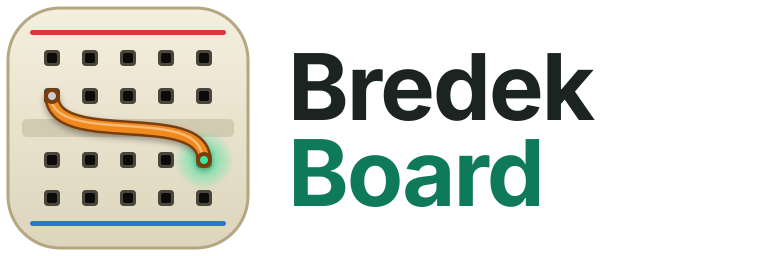
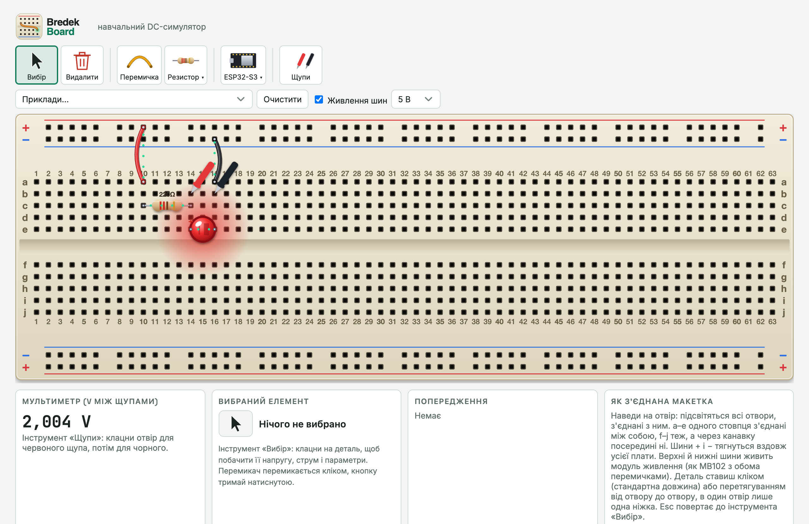
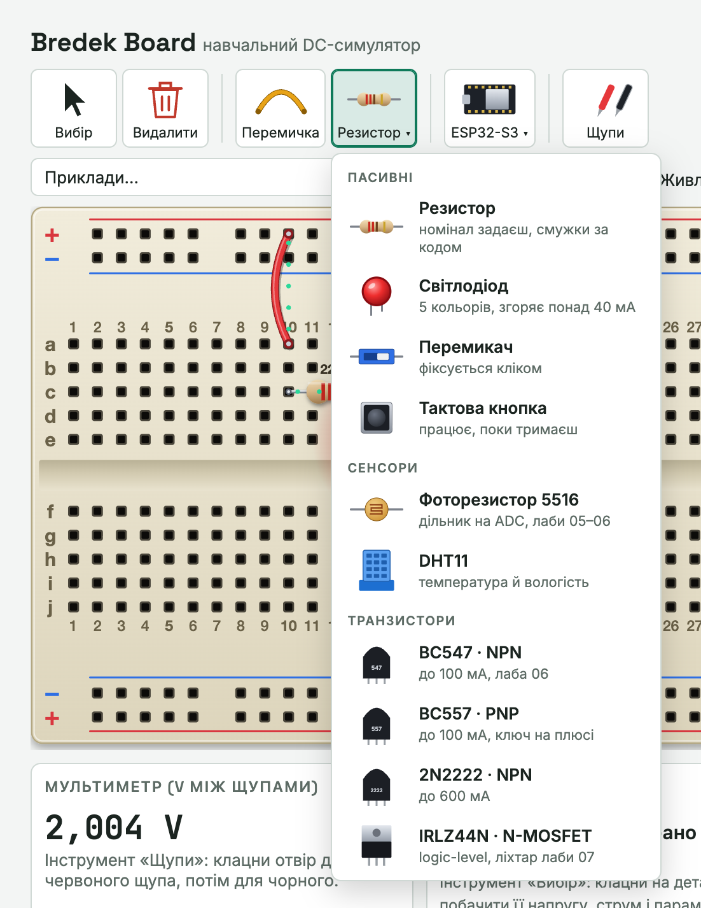
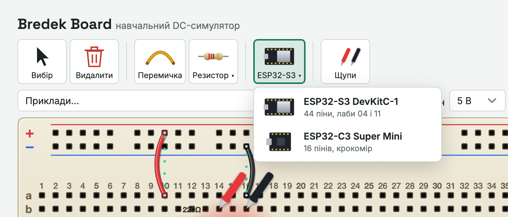
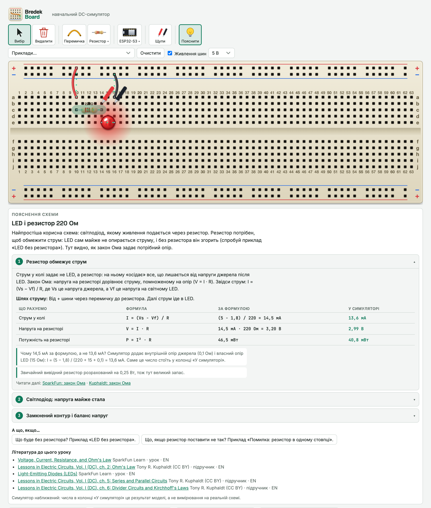

# Bredek Board

Навчальний симулятор електросхем постійного струму на віртуальній макетці. Один HTML-файл без залежностей і збірки.

- `index.html`: макетка 830 з ESP32-S3 і C3 Super Mini, DHT11, транзисторами BC547, BC557, 2N2222 та IRLZ44N, резисторами, LED, кнопкою, перемикачем і LDR. Є мультиметр із щупами, картки пінів, попередження про перегрів, 10 готових прикладів.

## Запуск

Відкрий `index.html` у браузері. Інтернет потрібен лише для шрифтів Google Fonts, без них сторінка працює зі стандартними.

## Як користуватися (1 хвилина)

1. **Подивись приклад.** У списку «Приклади…» вгорі обери будь-який, і схема збереться сама.
2. **Постав деталь.** Меню **Компоненти ▾** містить резистор, LED, кнопку, перемикач, LDR, DHT11 і транзистори.
   - Резистор, LED, кнопка, перемикач, LDR та **Перемичка**: *перетягни* від одного отвору макетки до іншого. Це дві ніжки деталі.
   - Транзистори і DHT11 мають 3 ніжки: *клікни* в отвір, деталь займе 3 отвори підряд у рядах a–j.
3. **Постав мікроконтролер.** Меню **Контролер ▾**: ESP32-S3 або C3 Super Mini. Клікни на макетці, плата сяде на місце. Піни виходять у вільні отвори над і під нею.
4. **З'єднай** піни з деталями перемичками. Для кожного підключеного піна внизу з'явиться картка: напруга, струм, режим (вхід, підтяжка, вихід HIGH/LOW, кнопка).
5. **Вимірюй.** Інструмент **Вибір** показує напругу й струм деталі, перемикач клацається, кнопку тримай. Інструмент **Щупи**: клікни отвір для червоного щупа, потім для чорного, і побачиш напругу між ними.

Меню **Компоненти ▾** і **Контролер ▾**:

| Інструмент | Дія |
|---|---|
| Вибір | Показати дані деталі, клацнути перемикач, потримати кнопку |
| Видалити | Клік по деталі прибирає її |
| Перемичка | Дріт між двома отворами |
| Компоненти ▾ / Контролер ▾ | Випадні меню деталей і плат (знімок вище) |
| Щупи | Мультиметр між двома отворами |

6. **Зрозумій схему.** Відкрий приклад і натисни **Пояснити** на панелі інструментів. Під макеткою з'явиться розбір: навіщо схема зібрана, з яких блоків вона складається, як іде струм, розрахунки за законом Ома з живими числами з симулятора, а також література для читання. Блок, який ти відкриваєш, підсвічується на макетці.

`Esc` повертає до «Вибір», `Delete` видаляє вибрану деталь.

Отвори a–e одного стовпця з'єднані між собою, f–j теж, а через канавку ні. Шини + і − тягнуться вздовж усієї плати. Курсор на отворі підсвічує все, що з ним з'єднано.

Повний гайд із описом інтерфейсу, сенсорів, режимів пінів і типових помилок: **[docs/how-it-works.md](docs/how-it-works.md)**.

## Як рахується

Метод вузлових потенціалів (MNA): матриця провідностей, розв'язок методом Гаусса. LED кусково-лінійний (поріг Vf плюс 15 Ом), джерело має внутрішній опір, BJT має діод база-емітер 0,65 В, струм колектора β·Ib і насичення 0,1 В, MOSFET є залежним від Vgs опором. Стан приладів уточнюється ітераціями до збіжності.

## Буде додано в наступних версіях

- Виконання програми ESP32 (зараз стан пінів ставиться вручну).
- Конденсатор.
- Осцилограф.
- Збереження і завантаження схем.
- Режим уроку на весь екран із кнопками «Далі».
- Автоматичне пояснення довільної схеми, зібраної самостійно (зараз пояснення є для 10 готових прикладів).

Моделі наближені, це навчальний інструмент, а не заміна SPICE чи вимірів. Порядок пінів C3 Super Mini і DHT11 взято з пам'яті, звір із власною платою.

## Ліцензія

[MIT](LICENSE).
