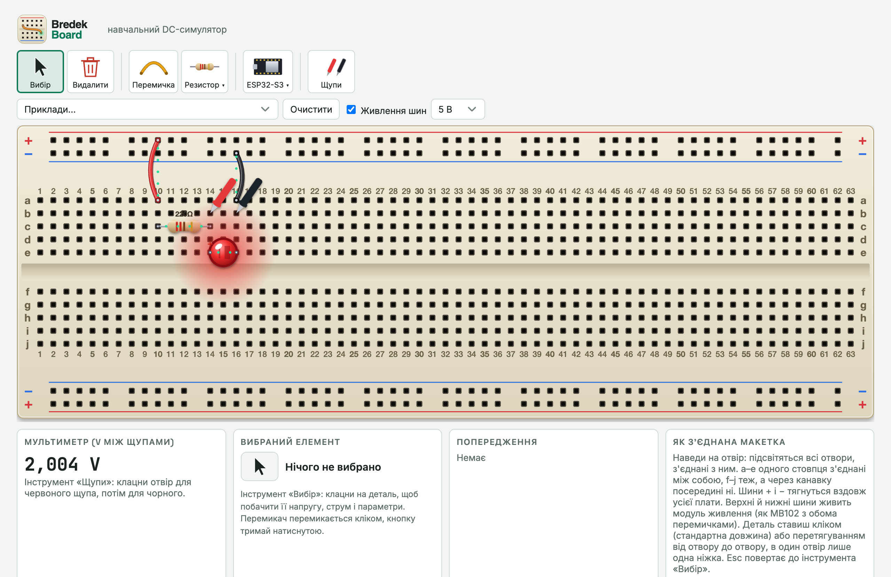
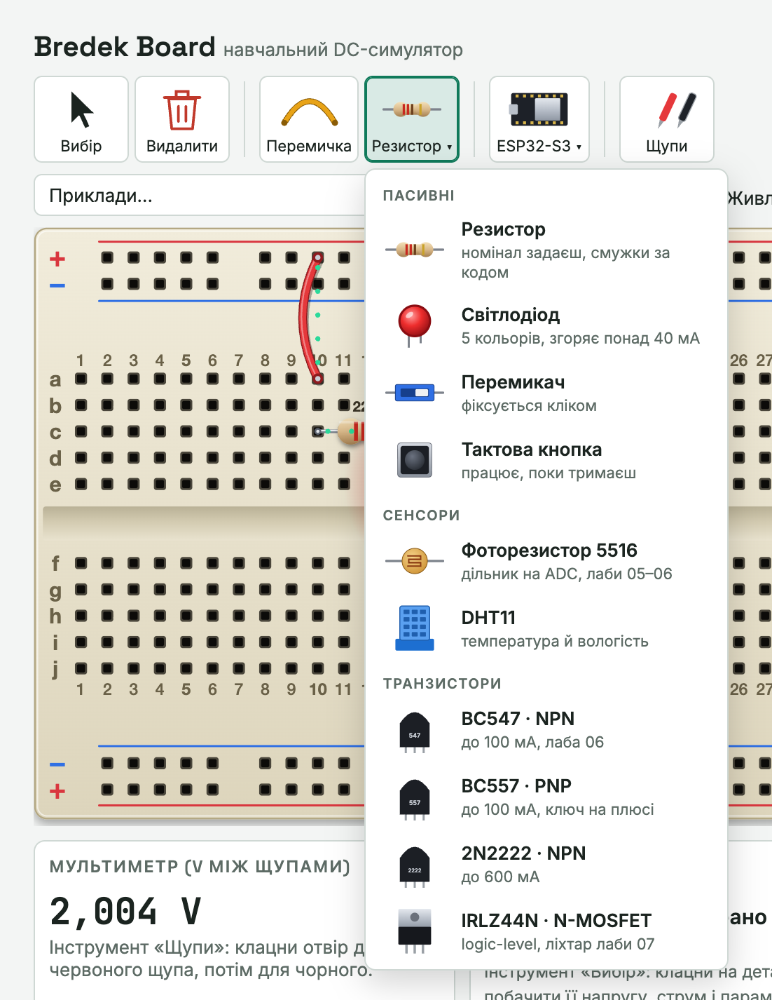
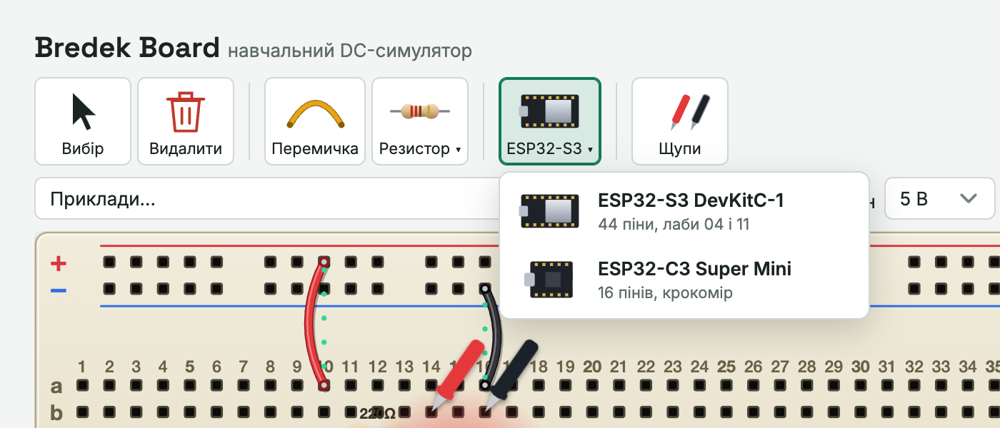
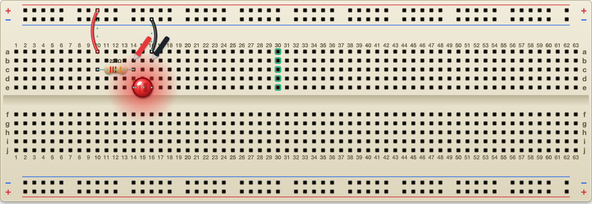
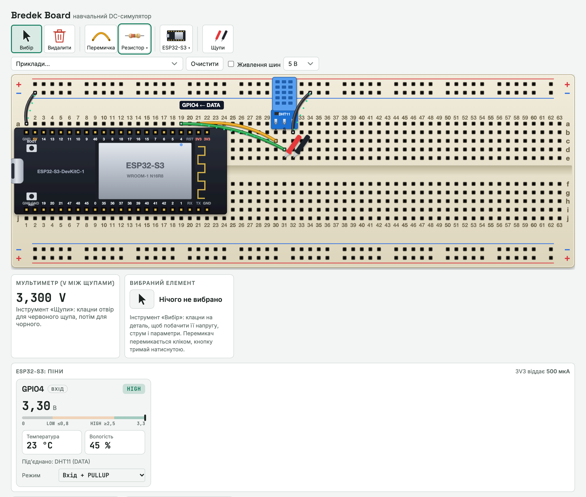
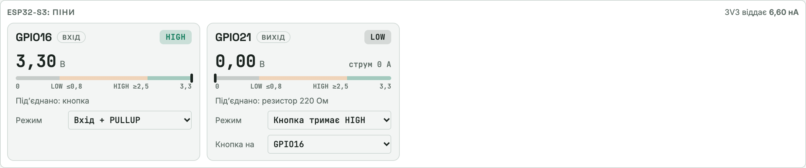
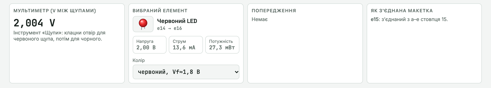
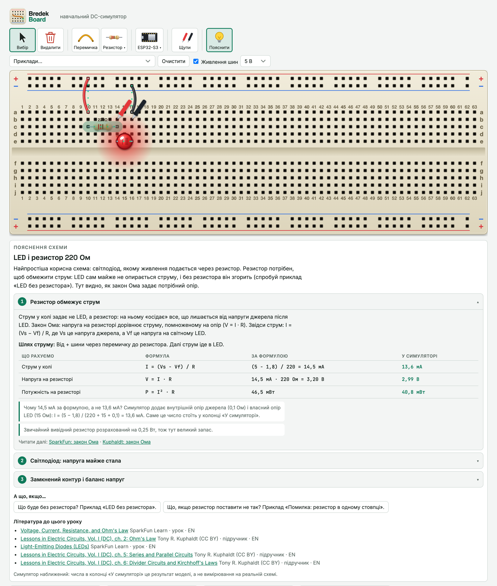

# Як користуватися Bredek Board

Гайд на 1-2 хвилини. Відкрий `index.html` у браузері і йди за кроками.

## 1. Швидкий старт

1. У списку **Приклади…** обери будь-який, наприклад «LED + резистор 220 Ом (5 В)».
2. Схема з'явиться на макетці, а LED засвітиться, якщо все з'єднано правильно.
3. Клацни по деталі інструментом **Вибір**: праворуч у картці побачиш напругу, струм і параметри.

Так найшвидше зрозуміти, як усе влаштоване. Далі збери свою схему.

## 2. Інтерфейс

Зверху вниз:
1. **Панель інструментів** (ряд кнопок).
2. **Рядок керування**: приклади, очистка, живлення шин, напруга.
3. **Макетка 830** з деталями.
4. **Картки**: мультиметр, вибраний елемент, попередження, підказка про з'єднання. Коли на макетці стоїть плата, з'являється ще картка «Піни плати».

| Інструмент | Що робить |
|---|---|
| **Вибір** | Клік по деталі показує її дані. Перемикач перемикається кліком, кнопка діє, поки її тримаєш. |
| **Видалити** | Клік по деталі, платі чи щупу прибирає його. |
| **Перемичка** | Дріт між двома отворами. |
| **Компоненти ▾** | Випадне меню з деталями (див. нижче). |
| **Контролер ▾** | Випадне меню з платами (див. нижче). |
| **Щупи** | Мультиметр. Клікни отвір для червоного щупа, потім для чорного. Напруга між ними з'явиться в картці «Мультиметр». |

Меню **Компоненти ▾**: пасивні деталі, сенсори, транзистори. Під назвою кожної деталі є коротка підказка.

Меню **Контролер ▾**:

Над макеткою також є:
- **Очистити** прибирає все з поля.
- **Живлення шин** вмикає і вимикає живлення.
- **5 В / 3,3 В** обирає напругу на шинах.

**Esc** завжди повертає до інструмента «Вибір». **Delete** або **Backspace** видаляє вибрану деталь.

## 3. Як влаштована макетка

- Отвори **a–e** в одному стовпці з'єднані між собою. **f–j** теж, а через канавку посередині ні.
- Довгі шини **+** і **−** з'єднані вздовж усієї плати. Верхні й нижні шини живить модуль живлення.
- Наведи курсор на отвір, і підсвітяться всі отвори, з'єднані з ним. Це допомагає знайти помилку.
- В один отвір ставиться лише одна ніжка.

Приклад: курсор на отворі `c30`. Зелені рамки показують усі отвори, з'єднані з ним, це a–e стовпця 30.

## 4. Як ставити деталі

### Прості деталі (резистор, LED, перемикач, кнопка, LDR, перемичка)

1. Обери деталь у меню **Компоненти ▾** (або інструмент **Перемичка**).
2. **Перетягни** від одного отвору до іншого. Ці два отвори і є ніжки деталі.
3. Клік по одному отвору ставить деталь стандартної довжини.

Резистор: клікни його інструментом «Вибір» і впиши номінал в Омах. Смужки на корпусі змінюються за кольоровим кодом.
LED: у картці вибираєш колір, у кожного свій Vf. Якщо LED згорів, там же є кнопка «Замінити згорілий LED».
Перемичка: у картці можна змінити колір. На розрахунок це не впливає, але звично червоний для +, чорний або синій для GND.

### Деталі з трьома ніжками (транзистори, DHT11)

Їх **не тягнуть**, а **клікають** у вибраний отвір:
- Деталь займає **3 отвори підряд** в одному ряду.
- Ставити можна лише в ряди **a–j**, не в шину.
- Транзистори: BC547 (NPN), BC557 (PNP), 2N2222 (NPN), IRLZ44N (N-MOSFET).
- Порядок ніжок залежить від моделі, він написаний у картці деталі: «Ніжки зліва направо: …». Наприклад, у BC547 це C B E, у 2N2222 E B C, у IRLZ44N G D S.

### Сенсори

| Сенсор | Як ставиться | Що налаштовується |
|---|---|---|
| **LDR (фоторезистор)** | Як звичайний резистор, двома ніжками. | Опір береться при 99 лк. Типова схема: дільник з резистором 10 кОм і вихід на АЦП, див. приклад «Дільник LDR». |
| **DHT11** | Клік у 3 вільні отвори. Ніжки зліва направо: **+ VCC, S DATA, − GND**. | У картці задаєш температуру (0–50 °C) і вологість (20–90 %). Пін DATA має бути входом, краще з підтяжкою, див. приклад «DHT11 на ESP32-S3». |

Покази DHT11 видно в картці того піна ESP32, до якого під'єднано DATA. На знімку приклад «DHT11 на ESP32-S3»: DATA іде на GPIO4, а картка піна показує 23 °C і 45 %.

### Мікроконтролери

1. Обери **Контролер ▾**: ESP32-S3 DevKitC-1 або ESP32-C3 Super Mini.
2. Клікни на макетці. Плата сяде на макетку своєю шириною. **На макетці може бути лише одна плата**, щоб поставити іншу, спершу видали першу.
3. З'єднай пін плати з деталлю перемичкою. Піни плати виходять у вільні отвори над і під нею.
4. Внизу з'явиться картка **Піни плати**. Для кожного підключеного піна там є:
   - напруга і рівень (**HIGH ≥ 2,5 В**, **LOW ≤ 0,8 В**, між ними «?»),
   - струм виходу, а понад 40 мА з'являється попередження,
   - перелік деталей, під'єднаних до піна,
   - список **Режим**.

Так виглядають картки двох пінів у прикладі «ESP32-S3: LED на GPIO21 + кнопка GPIO16». GPIO16 читає кнопку з підтяжкою, GPIO21 керує LED за кнопкою:

Режими піна (код ESP32 не виконується, режим ти задаєш вручну):

| Режим | Що означає |
|---|---|
| Вхід | Пін тільки читає напругу. |
| Вхід + PULLUP / PULLDOWN | Те саме з внутрішньою підтяжкою до 3,3 В або до GND. |
| Вихід HIGH / LOW | Пін постійно віддає 3,3 В або 0 В. |
| Кнопка тримає HIGH | Імітація програми «світити, поки натиснута кнопка». Нижче вибираєш, яка кнопка (на якому піні). |
| Кнопка перемикає | Імітація програми «кожне натискання перемикає стан». |

## 5. Читання результатів

- **Вибраний елемент**: напруга, струм і потужність деталі. LED, резистор, транзистор, DHT11 і плата мають власні поля (колір LED, опір, температура тощо).

На знімку вибрано червоний LED (13,6 мА при 2,00 В), а мультиметр показує напругу між щупами.

- **Мультиметр**: напруга між двома щупами.
- **Попередження**: перегрів резистора, LED без резистора, перевантаження піна, помилки на кшталт «резистор в одному стовпці». Деталь, що перегоріла, змінює вигляд.
- Рух струму на схемі показано анімацією.

## 6. Режим «Пояснити»

Кнопка **Пояснити** на панелі інструментів (лампочка) вмикає розбір схеми. За замовчуванням вона вимкнена і нічого не змінює в роботі симулятора.

1. Відкрий будь-який приклад у списку **Приклади…**.
2. Натисни **Пояснити**. Під макеткою з'явиться картка з поясненням.
3. Читай зверху вниз:
   - **Призначення:** навіщо зібрана схема.
   - **Блоки** (1, 2, 3...): логічні вузли схеми. Клікни на заголовок блока, щоб розкрити його. Відкритий блок підсвічується на макетці.
   - У блоці є: що він робить, шлях струму, таблиця розрахунку й посилання «Читати далі».
   - **А що, якщо…:** кнопки переходу на приклади, які показують, що буде, якщо схему змінити.
   - **Література до цього уроку:** перелік джерел із типом і мовою.

**Таблиця розрахунку** має чотири колонки: що рахуємо, формула, значення за формулою («ідеальне») і значення **у симуляторі**. Друга колонка береться з живого розрахунку, тому змінюється разом зі схемою: натисни кнопку, і числа оживуть. Значення зазвичай трохи різняться, бо модель додає реальні дрібниці (внутрішній опір джерела, власний опір LED). Під таблицею завжди написано, звідки різниця.

Якщо після відкриття прикладу ти змінив схему, зверху з'явиться позначка «Схему змінено», а підсвітка зникне: пояснення написане для оригіналу. Кнопка **Повернути приклад** відновлює схему.

Пояснення поки є для 10 готових прикладів. Модель симулятора наближена, тому числа це результат моделі, а не вимірювання на реальній схемі.

## 7. Типові помилки

| Симптом | Причина |
|---|---|
| Нічого не світиться | Вимкнено **Живлення шин** або нема кола між + і −. |
| LED згорів | Нема резистора, струм понад 40 мА. Спробуй приклад «LED без резистора». |
| Деталь «закорочена» | Обидві ніжки в одному стовпці (a–e або f–j). Приклад «Помилка: резистор в одному стовпці». |
| Не ставиться транзистор чи DHT11 | Потрібні 3 вільні отвори підряд у рядах a–j. |
| Рівень «?» на піні | Напруга між 0,8 і 2,5 В: плата читає і 0, і 1. Додай підтяжку. |
| DHT11 «мовчить» | DATA не під'єднано до піна плати, або пін не вхід. |

## 8. Буде додано в наступних версіях

- Виконання програми ESP32: зараз стан пінів ставиться вручну через режими.
- Конденсатор.
- Осцилограф.
- Збереження і завантаження схем.
- Режим уроку на весь екран із кнопками «Далі».
- Автоматичне пояснення довільної схеми, зібраної самостійно.

Поки що це наближена навчальна модель, а не заміна SPICE чи вимірів. Порядок пінів C3 Super Mini та DHT11 звір із власною платою.
